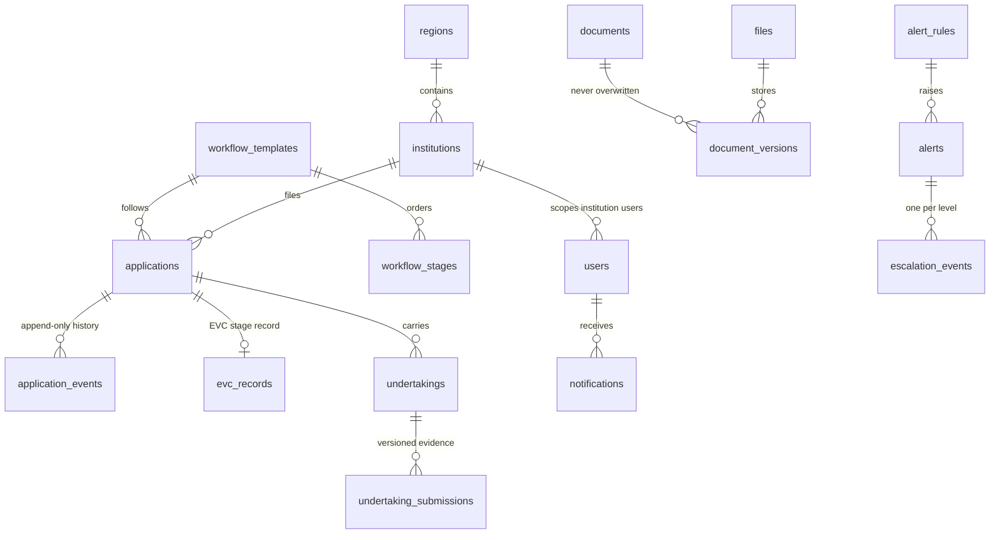

# Architecture

## Stack

| Layer | Used | Note |
|---|---|---|
| Framework | Next.js 16 (App Router), React 19, TypeScript (strict) | Server components and server actions keep writes on the server |
| UI | Tailwind CSS 4, hand-built components in `src/components/ui.tsx`, Lucide icons, Sonner toasts, cmdk, Motion | shadcn/ui was not used; the same accessible patterns are hand-written to keep the bundle small |
| Charts | Recharts | Pendency chart on the overview and reports |
| Database | PGlite (Postgres 17 in WASM) on local disk | Real SQL, constraints, triggers and transactions |
| Migrations | Versioned SQL in `src/server/db/migrations.ts`, recorded in `schema_migrations` | Drizzle was not used: plain SQL keeps the schema and triggers readable |
| Validation | Zod, on the server for every write | |
| Tests | Vitest (unit and integration on in-memory PGlite), Playwright (walkthroughs) | |

## Layers

```
UI (server components + client islands)
  └─ server actions (src/app/actions.ts)  session check, error mapping, revalidate
       └─ services (src/server/services/*)  business rules, permission checks, audit
            └─ db (src/server/db/*)  PGlite; each service call runs in one transaction
```

- **Services take `(db, actor, input)`** and return plain data. They do not know about HTTP or React, so tests call them directly.
- **Permissions** are a role → permission table (`src/server/permissions.ts`). `assertCan` runs before every write. Record scope (`scopeWhere`, `canViewRecord`) runs before every read that can cross institutions or regions.
- **Audit** (`audit()`) is called inside the same transaction as the change it records.
- **Notifications** (`notifyRole()`) are created inside the same transaction as the event that triggers them.

## Data model (main tables)



Key constraints:
- `alerts` is unique on `(rule_id, entity_type, entity_id, threshold_key)`. This is the deduplication guarantee.
- `escalation_events` is unique on `(alert_id, level)`. This makes escalation idempotent.
- `application_events` and `audit_logs` have triggers that raise an error on UPDATE or DELETE.
- Checks on enumerated states (status, role, outcome, review status) and file size.

## Workflow engine

- A template is an ordered list of stages. Each stage has an owner role, a target in days, an optional checklist, and flags for EVC, committee and final decision.
- `completeStage` requires: the application is in progress; the actor's role equals the stage owner role; every checklist item is confirmed; for an EVC stage, the visit is recorded. It then moves to the next position, sets a new deadline, and creates the EVC record if the next stage is EVC.
- `returnForClarification` and `respondToClarification` pause and resume the same stage. A reason is required.
- `recordDecision` is only for the final stage, only for the competent authority role, and needs an explicit confirmation.

## Monitoring engine

1. For each enabled rule, a collector returns the records with a due date. Each rule has its own collector (stage deadline, EVC, undertaking, document expiry, review turnaround).
2. The days left are computed from the demo clock. The threshold key is `overdue` or `within-N` (the smallest configured threshold ≥ days left).
3. If an open alert for the record already has that key, it counts as a duplicate and is skipped. If it has a different key, the old alert is superseded and resolved, then a new one is created. A resolved alert with the same key is re-opened when the condition returns.
4. Open alerts whose record no longer appears are resolved automatically ("condition cleared").
5. Overdue alerts climb the escalation ladder. Level *n* fires once the rule's escalation delay × *n* has passed. Each level is recorded once and notifies the target role.
6. The run writes an audit entry and stores its summary as the last run.

Run from the UI (Tasks & escalations) or Demo Control. No background timer runs; a scheduler would call `runMonitoringChecks` on an interval.

## Security model

- **Authentication:** demo accounts. A signed, httpOnly, SameSite=lax cookie holds the user ID and an HMAC-SHA256 signature. Changing the secret invalidates all sessions. Production would need real identity.
- **Authorization:** checked in services, not in the UI. Hidden buttons are a convenience, not the control.
- **Scoping:** institution users see only their institution; regional officers only their region. Not-found and forbidden-by-scope look identical, so IDs cannot be probed.
- **Files:** size limit 10 MB; accepted types are decided by leading bytes and must match the extension; downloads go through an authorized route with `nosniff` and `no-store`; each download is audited.
- **CSV:** cells beginning with `= + - @` are prefixed with an apostrophe to block spreadsheet formula injection.
- **Errors:** users see plain messages. Internal errors are logged on the server and reported as "nothing was saved".
- **Secrets:** none in the repository. `.env.example` has placeholders only.

## Deviations from the brief

- Drizzle ORM and shadcn/ui were replaced with plain SQL migrations and hand-written accessible components, to reduce moving parts.
- Each user has one role (not a join table of roles).
- Files are stored in the database rather than a private folder.
- Row-level security policies were not written; scoping is enforced and tested in code.
- Email, SMS, scheduled jobs and AICTE integrations are not implemented.
